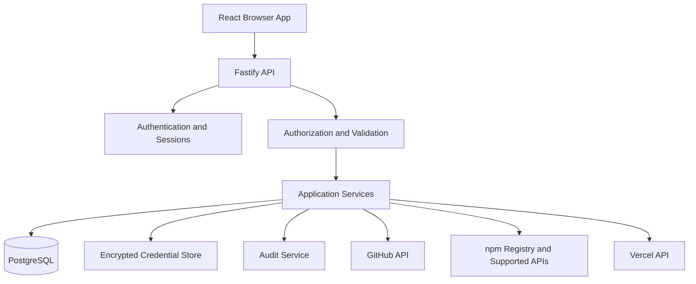

# MixCraft — System Architecture

**Version:** 1.0  
**Architecture style:** Modular monolith  
**Language:** TypeScript  
**Database:** PostgreSQL

## 1. Overview

MixCraft is a web application with a React frontend, Fastify API, PostgreSQL database, secure credential storage, and provider-specific adapters for GitHub, npmjs, and Vercel.

Use a modular monolith for the MVP. Keep clear boundaries between authentication, application services, provider adapters, and persistence so that modules remain testable and replaceable.



The browser calls MixCraft's API. Provider credentials never enter browser storage or frontend bundles.

## 2. Recommended Stack

- Frontend: React, TypeScript, Vite, React Router, TanStack Query, Zod.
- Backend: Node.js, TypeScript, Fastify, Zod.
- Database: PostgreSQL and Prisma.
- Tests: Vitest and an end-to-end browser test runner.
- Workspace: pnpm monorepo.
- Optional background jobs: Redis and BullMQ when synchronization or webhook volume justifies them.
- Deployment: frontend on Vercel or equivalent; API on a persistent Node.js host; managed PostgreSQL.

Do not introduce a queue or microservices before a real need exists.

## 3. Module Boundaries

### Frontend
Responsible for routing, presentation, local interaction state, query caching, and calling MixCraft endpoints. It is not a security boundary.

### API routes
Authenticate requests, validate inputs, invoke services, normalize responses, and attach request context. Keep route handlers thin.

### Application services
Coordinate use cases such as `AccountConnectionService`, `RepositoryService`, `PackageService`, `DeploymentService`, `DashboardService`, `CredentialService`, and `AuditService`.

### Provider adapters
Each adapter owns its authorization-specific operations, API calls, pagination, response mapping, rate-limit handling, and provider error normalization.

## 4. Provider Contract

Keep shared interfaces small. Resource-specific methods should be typed rather than exposing an arbitrary `executeAnyRequest` proxy.

```ts
export interface ProviderAdapter {
  readonly provider: "github" | "npm" | "vercel";
  validateConnection(connectionId: string): Promise<ConnectionHealth>;
  getCapabilities(connectionId: string): Promise<ProviderCapabilities>;
}

export interface ConnectionHealth {
  connected: boolean;
  checkedAt: string;
  reason?: string;
}

export interface ProviderCapabilities {
  canRead: boolean;
  canWrite: boolean;
  operations: string[];
}
```

Capability metadata is not authorization. Check ownership, policy, and provider permissions on every operation.

## 5. Authentication

### GitHub login
1. Browser starts login at the backend.
2. Backend creates a short-lived, single-use authorization transaction.
3. Browser redirects to GitHub.
4. Callback validates state and exchanges the code using the registered flow.
5. Backend resolves the stable GitHub identity.
6. Backend creates or retrieves the local user.
7. Session ID is rotated and delivered in a secure cookie.

Use PKCE where supported by the selected flow. Keep client secrets and GitHub App keys server-side.

### GitHub resource access
Distinguish the GitHub identity used for login from GitHub App installation access and any user access token. Use a GitHub App where its permission model fits the required operations. Installation tokens are short-lived and scoped; do not treat them as permanent user credentials.

### npm connection
Use a supported npm granular access token as the initial connection method:
1. Explain required permissions.
2. Accept the token over HTTPS through a protected endpoint.
3. Validate it through a supported operation.
4. Encrypt and store it.
5. Return only safe connection metadata.

Do not ask for npm passwords or invent an npm OAuth flow.

### Vercel connection
Use Vercel's supported OAuth integration. Validate state, exchange the code, encrypt credentials, resolve the authorized account, and record scopes/status. Confirm exact flow requirements against the registered integration and current official documentation.

### Sessions
Use server-managed sessions and cookies with `HttpOnly`, `Secure` in production, suitable `SameSite`, restrictive path, idle expiry, and absolute expiry. Rotate session identifiers after login and privilege changes. Protect state-changing requests against CSRF. Never store session IDs or provider tokens in local storage.

## 6. Database Schema

### `users`
- `id` UUID primary key
- `github_user_id` stable unique identity
- `github_login`
- `display_name`, `avatar_url`
- `created_at`, `updated_at`, `last_login_at`

### `sessions`
- `id`, `user_id`
- `session_hash`
- `created_at`, `last_seen_at`, `expires_at`, `revoked_at`

Store a suitable hash of the opaque session secret, not the raw cookie value.

### `provider_connections`
- `id`, `user_id`, `provider`
- `provider_account_id`, `provider_account_name`
- `status`, `scopes`
- `last_validated_at`
- `created_at`, `updated_at`, `disconnected_at`

Use foreign keys and uniqueness constraints that allow the intended account multiplicity.

### `encrypted_credentials`
- `id`, `connection_id`, `credential_kind`
- `ciphertext`, `nonce`, `authentication_tag` if stored separately
- `key_version`, `expires_at`, `created_at`, `updated_at`

Use authenticated encryption such as AES-256-GCM. Keep keys in managed secret storage or KMS, not PostgreSQL. Store refresh credentials only where supported and needed.

### `oauth_transactions`
- `id`, `provider`, `state_hash`
- `pkce_verifier_ciphertext` where applicable
- `browser_session_binding`
- `expires_at`, `consumed_at`

Transactions are short-lived and single-use.

### `github_installations`
- `id`, `connection_id`, `installation_id`
- `account_type`, `account_login`, `suspended_at`
- timestamps

Installation metadata does not prove access to every repository.

### `resource_cache`
- `id`, `connection_id`, `provider`, `resource_type`
- `provider_resource_id`, `payload`, `fetched_at`, `expires_at`

Cache only necessary non-secret metadata.

### `audit_events`
- `id`, `user_id`, `connection_id`
- `action`, `resource_type`, `resource_id`
- `outcome`, `request_id`, sanitized `metadata`, `created_at`

Never include tokens or secrets.

### `webhook_events`
- `id`, `provider`, `provider_event_id`, `event_type`
- `received_at`, `processed_at`, `status`

Verify signatures and deduplicate events before processing.

## 7. API Routes

Use consistent internal routes. A versioned prefix such as `/api/v1` can be introduced when API stability is needed.

### Authentication
- `GET /api/auth/github`
- `GET /api/auth/github/callback`
- `POST /api/auth/logout`
- `GET /api/me`

### Connections
- `GET /api/connections`
- `POST /api/connections/npm`
- `GET /api/connections/vercel/start`
- `GET /api/connections/vercel/callback`
- `DELETE /api/connections/:provider/:connectionId`

### GitHub
- `GET /api/github/repositories`
- `POST /api/github/repositories`
- `GET /api/github/repositories/:owner/:repo`
- `GET /api/github/repositories/:owner/:repo/branches`
- `GET /api/github/repositories/:owner/:repo/commits`
- `GET /api/github/repositories/:owner/:repo/pulls`
- `POST /api/github/repositories/:owner/:repo/pulls`
- `GET /api/github/repositories/:owner/:repo/actions/runs`

### npm
- `GET /api/npm/packages`
- `GET /api/npm/packages/:packageName`
- `GET /api/npm/packages/:packageName/versions`
- `POST /api/npm/packages/:packageName/stage`
- `POST /api/npm/packages/:packageName/deprecate`

### Vercel
- `GET /api/vercel/projects`
- `GET /api/vercel/deployments`
- `POST /api/vercel/deployments`
- `GET /api/vercel/projects/:projectId/env`
- `POST /api/vercel/projects/:projectId/env`
- `DELETE /api/vercel/projects/:projectId/env/:envId`

Implement only endpoints backed by verified provider capabilities and permissions. The list is a planning contract, not a claim that every operation is supported by every integration.

### Response shape

```json
{
  "data": {},
  "meta": { "requestId": "req_example" }
}
```

Errors:

```json
{
  "error": {
    "code": "PROVIDER_PERMISSION_DENIED",
    "message": "This action is not permitted for the connected account.",
    "requestId": "req_example"
  }
}
```

Do not expose raw provider error bodies or sensitive headers.

## 8. Authorization Sequence

For every write request:
1. Authenticate session.
2. Validate input and resource identifier.
3. Resolve the user's connection.
4. Verify connection ownership.
5. Verify operation support.
6. Check local policies and known capabilities.
7. Obtain the correct provider credential.
8. Call provider API.
9. Normalize outcome.
10. Record sanitized audit event.
11. Return a safe response.

The provider's final authorization decision is authoritative because permissions can change between checks.

Require explicit confirmation for repository deletion or visibility changes, package publishing/deprecation, production deployments, environment changes, and access-control changes. For uncertain outcomes, verify provider state before retrying.

## 9. Error Normalization

Suggested internal categories:
- `AUTHENTICATION_REQUIRED`
- `CONNECTION_EXPIRED`
- `PERMISSION_DENIED`
- `RESOURCE_NOT_FOUND`
- `VALIDATION_FAILED`
- `RATE_LIMITED`
- `PROVIDER_UNAVAILABLE`
- `OPERATION_CONFLICT`
- `OUTCOME_UNKNOWN`

Respect retry-after headers. Retry only when safe and idempotent.

## 10. Background Processing

Add jobs for cache refresh, webhook processing, resource synchronization, connection health, and safe transient retries only when required. Jobs need idempotency, bounded retries, structured logs, and terminal failure states. Never blindly retry high-impact operations.

## 11. Security

- HTTPS in production.
- Encrypt provider credentials with managed key material.
- Redact secrets from logs and errors.
- Verify ownership before credential decryption.
- Apply CSRF protection, rate limiting, secure headers, and restrictive CORS.
- Validate callback URLs and avoid arbitrary outbound URL proxies.
- Verify webhook signatures against the raw body.
- Minimize retained account metadata and define deletion policies.
- Use separate development, staging, and production credentials.

## 12. Testing

Unit tests: policy checks, validation, error mapping, encryption, session expiry, confirmation requirements.

Integration tests: migrations, connection ownership, OAuth transaction validation, adapter behavior with mocked HTTP responses, audit creation.

E2E tests: login/logout, connections, resource browsing, permission-denied states, responsive navigation, and critical dialogs.

Use test accounts or mocks, never production credentials in test fixtures.

## 13. Deployment

- Frontend on Vercel or another suitable host.
- API on a persistent Node.js host.
- Managed PostgreSQL with backups and migration controls.
- Managed secrets and separate environment configuration.
- Health checks, structured logs, error monitoring, rate limits, and rollback documentation.

## 14. Extensibility

Potential future adapters: GitLab, Bitbucket, Cloudflare, Railway, and Render. Each must provide its own authorization flow, capabilities, typed operations, tests, and connection settings.

Record major decisions in `docs/adr/` with context, options, decision, consequences, security implications, and migration needs.

## 15. OpenCode Rules

- Read this document before architecture-sensitive changes.
- Preserve provider boundaries and thin route handlers.
- Avoid arbitrary provider proxy endpoints.
- Use typed interfaces and validated input.
- Use clearly labelled mocks when credentials are unavailable.
- Never fabricate successful external operations.
- Add tests for authorization and provider errors.
- Update architecture documentation when material decisions change.
